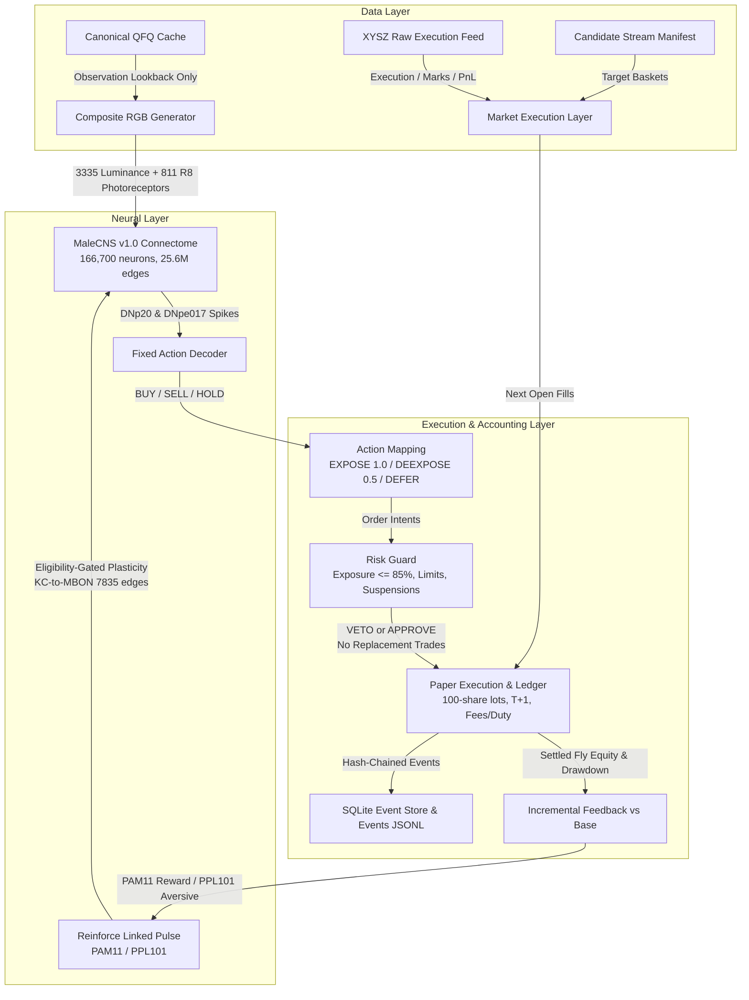

# Stonkfly Project Handoff

Status: Canonical project handoff and architecture guide for incoming agents and reviewers.
Lineage: Paper-only research; strictly separates sensory proxies, connectome propagation, plasticity, fixed decoding, execution limits, and accounting.

---

## 1. Start-Here Reading Order

To understand system architecture, completed milestones, governance gates, and pending tasks, read documents in this exact order:

1. **[AGENTS.md](file:///home/ubuntu/stonkfly-lab/AGENTS.md)**
   - Core immutable project laws: preserve full MaleCNS v1.0 graph (no pruning, no scripted trades, no LLM trading policy), risk guards only veto (never select replacement trades), paper-only default, Decimal quantities, persist intents before execution, no biological/profit learning claims, keep README short.
2. **[PROJECT_HANDOFF.md](file:///home/ubuntu/stonkfly-lab/docs/PROJECT_HANDOFF.md)** (this document)
   - Authoritative architecture, dataflow, gate status, artifact provenance, worktree caveats, fast test commands, and 2021 feasibility verdict.
3. **[wc006.md](file:///home/ubuntu/stonkfly-lab/docs/wc006.md)**
   - Multi-symbol paper contract: causal timing (observe at close $T$, execute at open $T+1$), composite RGB frame, 100-share lots, T+1 sell availability, paired deterministic base arm, and hash-chained SQLite event ledger.
4. **[v51_corrected_branch_b_baseline.md](file:///home/ubuntu/stonkfly-lab/docs/experiments/v51_corrected_branch_b_baseline.md)**
   - Authoritative 2022 baseline audit evidence: historical Branch A sensitivity qualification vs corrected Branch B bit-identical direct quant base, full-year replay metrics, hash chains, and Jev gate policy.
5. **[audit/independent-qfq-2022/audit.json](file:///home/ubuntu/stonkfly-lab/audit/independent-qfq-2022/audit.json)** & **[audit.md](file:///home/ubuntu/stonkfly-lab/audit/independent-qfq-2022/audit.md)**
   - Subcheck verdicts (`PASS_CORRECTED_BASELINE_ESTABLISHED_WITH_HISTORICAL_A_INVALIDATED`), exact file hashes, and performance gate definition.
6. **[wc006_v5_1_v6_mechanism_preregister.md](file:///home/ubuntu/stonkfly-lab/docs/experiments/wc006_v5_1_v6_mechanism_preregister.md)**
   - V5.1/V6 mechanism specification: linked reinforcement pulse separate from sensory phase, PAM11/PPL101 dopamine stimulation, eligibility-trace gating, and annual boundary rules.
7. **[wc006_v5_preregister.md](file:///home/ubuntu/stonkfly-lab/docs/experiments/wc006_v5_preregister.md)**
   - V5 baseline specification: paired `WC006-only` vs `WC006+Fly` primary comparison, signal/fill/reward linkage, requested vs effective multiplier mechanics.
8. **[wc006_v4_2021_2025_preregister.md](file:///home/ubuntu/stonkfly-lab/docs/experiments/wc006_v4_2021_2025_preregister.md)** & **[wc006_v3_2021_preregister.v2.md](file:///home/ubuntu/stonkfly-lab/docs/experiments/wc006_v3_2021_preregister.v2.md)**
   - Historical context on candidate stream development windows (`2021-07-01` start date, placeholder watch artifacts rejection, and data boundaries).
9. **[stonkfly/jev_ab.py](file:///home/ubuntu/stonkfly-lab/stonkfly/jev_ab.py)**
   - Jev A/B planning API, `ABConfig`, and lineage gate validator.

---

## 2. Architecture, Dataflow, and Authoritative Code Paths



### Component Boundaries
- **Sensory / Observation Layer**: Composite RGB images mapped to 3,335 luminance inputs and 811 color-sensitive R8 photoreceptors. The BaoStock QFQ cache is strictly restricted to observation frames; it is never used for execution fills, marks, or rewards. **Exception (2026-09-24):** the 2021 clean-start replay broke this rule. Its 19-record stream bypassed XYSZ loading and executed on QFQ, so that baseline is non-authoritative. `validate_v4_stream` now loads any supplied market manifest and fails closed.
- **Connectome Propagation**: Retains the full MaleCNS v1.0 graph without pruning or modification. Rate-based Leaky Integrate-and-Fire (LIF) photoreceptor proxy.
- **Plasticity Mode**: Gated at exactly 7,835 KC-to-MBON07/11 connections. Centered rate rule active only during linked dopamine pulses (`reinforce_linked`); passive decay during sensory observation.
- **Fixed Decoder**: Evaluates descending neurons DNp20 and DNpe017 over the decision window. Strictly mapped: `BUY -> 1.0` multiplier, `SELL -> 0.5`, `HOLD -> DEFER` (retaining prior multiplier). Decoder magnitude is explicitly ignored.
- **Risk Guard**: Checks uppercase/lowercase limit status, suspension, and 85% exposure cap. The guard can only veto; it **never** selects replacement orders or redistributes cash.
- **Accounting & Ledger**: Dual-ledger execution comparing `WC006+Fly` against deterministic `WC006-only` base arm using Decimal arithmetic, 100-share lots, T+1 settlement, and SQLite event chaining.

### Authoritative Code Paths
- `experiments/a_share/wc006_male_cns_v51_adapter.py`: Core V5.1 adapter (`_run_v51`, `run_v51_annual`, `_scope_dates`, `_validate_annual_manifest`).
- `experiments/a_share/wc006_v4_market.py`: `load_xysz_market_inputs`, `XyszMarketInputs`, official status and PIT corporate action handler.
- `experiments/a_share/replay_wc006.py`: `WC006Ledger`, intent queuing, lot tracking, event chaining.
- `stonkfly/neural/v51_controller.py`: `V51Controller`, `observe`, `reinforce_linked`.
- `stonkfly/neural/sensory_adapter.py`: `NullSensoryAdapter` (RGB-only baseline), `SensoryStimulation`.
- `audit/independent-qfq-2022/counterfactual-replay/run_chunk_replay.py`: Bounded, resumable chunk replay runner with SQLite WAL checkpointing.
- `audit/independent-qfq-2022/audit_xysz_qfq.py`: Independent audit verifying QFQ data, selector, Fly sensitivity, and lineage gates.
- `stonkfly/jev_ab.py`: Lineage validator, `make_plan`, and Jev A/B configuration schema.

---

## 3. Completed Milestones and Exact Gate States

| Milestone | Status | Key Artifacts | Current Gate State |
|---|---|---|---|
| **2022 QFQ Investigation & Baseline Audit** | **COMPLETE** | `audit/independent-qfq-2022/audit.json`, `audit.md` | `PASS_CORRECTED_BASELINE_ESTABLISHED_WITH_HISTORICAL_A_INVALIDATED` |
| **Historical Branch A Performance Claim** | **INVALIDATED** | `audit/independent-qfq-2022/counterfactual-replay/preserved-complete-branch-a-day-242/` | `BLOCKED_NONINVARIANT` (sensitivity-qualified; retained for sensitivity analysis only) |
| **Corrected Branch B 2022 Baseline** | **ESTABLISHED** | `audit/independent-qfq-2022/counterfactual-replay/branch-b/` | `PASS_TRUSTWORTHY`, Lineage ID: `corrected-branch-b-2022-v5.1` |
| **Jev A/B Performance Gate** | **GATED** | `stonkfly/jev_ab.py` | `UNBLOCKED_CORRECTED_B_LINEAGE_ONLY`, `auto_start=false`. Future paper-only experiments permitted only from verified corrected B lineage. |
| **2021 V5.1 Baseline** | **NON-AUTHORITATIVE (2026-09-24)** | `runs/wc006_v5_1_2021_baseline/` + `audit/p0-2021-002432-concentration/` | The replay completed, but three defects make it unusable as a baseline. (1) Execution ran on QFQ instead of XYSZ raw, so no official guards or corporate actions applied. (2) The WC006 selector trains on unpurged forward labels. (3) The Fly excess comes from rebalance retries after Base `total_exposure` vetoes. See `docs/experiments/v51_independent_clean_start_2021.md`. |
| **WC006 Selector Label Leak** | **CONFIRMED (2026-09-24)** | `audit/p0-2021-selector-leakage/` | `export_leading_daily_signal.py` trains up to the start of the signal month with no purge of the 20-day forward labels. This affects every WC006 candidate stream here, including 2021–2023, corrected-B and 2023. Purging the labels removes the edge. Walk-forward mean monthly net drops from 25.3% to 3.5% and win rate from 80% to 48%. In the 2021 re-export, 002432 falls from rank 1 (97.4%) to rank 6. Absolute Base/Fly returns on these streams are not performance evidence. |
| **WC006 Purge A/B (56 windows)** | **COMPLETE (2026-09-25)** | `audit/p0-2021-selector-leakage/purged_backtest_report.md` | Same cost/lag protocol; unpurged A `25.30% / 80.4%`, purged B `3.49% / 48.2%`. Research-only selector audit; not evidence of profitable learning. |
| **WC009 operational purge A/B (56 windows)** | **COMPLETE (2026-09-25)** | `audit/wc009-purge-20260925/wc009_purge_ab_compare.20260925.md` | Purged `mean_net_cum 5.0947%`, win rate `67.86%`; unpurged `42.6839%`, `91.07%`; purged-minus-unpurged `-37.5893pp`. Research-only, no model rerun or execution. Report SHA256: `df6b77d79dee07ce1e6d69f8247bad3e7468bf1509c87fedefc394f1d9ad1235`; JSON SHA256: `5dd20deee7ec50f8205ee1fb34855a6862fc63f592d45095463f50f3b5ffec85`. |
| **Purged phase-1 Fly/Base frozen baseline** | **COMPLETE (2026-09-25; research-only)** | `runs/wc006_purged_fly_base_baseline_phase1/20260925T-frozen-rgb-seed17/` | Candidate v2 `9a07849c4b910390a949934f3329bad7288142cce2acbea7ed3835bd5f77d7bc`, 46 records / 131 codes; XYSZ v6 `PASS_RESEARCH_ONLY`, manifest `bebf4922faef670d665da46d8aece75665a0ec090426997172a71ea26f33c39c`, QA `4fb438b60da507b443639746fdc11224da14239c5dedc0a8d4977ee358d267fe`. Fly `-18.93%`, Base `-7.80%`, Fly lag `11.13pp`; both max drawdown approximately `44%`. Performance summary SHA256: JSON `bbe5cb654fdc3b75f86559ae5937e514376ed6903fa271f2c73c14686dbd48f1`, Markdown `3101b7ca560957a3bd9b5b56dcc8abbc9f822e1e1d1322fcfcfa4f906e8ed6f0`; audit manifest `d25b9ae8b3d5e6e065f8f08fa9e5970f14fa89e2c9c96d6358b3973a99785e54`. These are descriptive accounting results only, not significance or profitable-learning claims. |

---

## 4. Authoritative vs Obsolete / Sensitivity-Only Artifacts

### Authoritative Artifacts

> **Caveat (2026-09-24):** corrected Branch B is authoritative only for execution and lineage fidelity. Its candidate stream comes from the WC006 exporter that trains on unpurged forward labels (same post-overlay hash `c76a6f8d…`). Its absolute returns and its Fly-vs-Base comparison must not be read as performance evidence until a purged candidate stream is rebuilt.

- **Corrected Branch B Replay**: `audit/independent-qfq-2022/counterfactual-replay/branch-b/`
  - Manifest: `audit/independent-qfq-2022/counterfactual-replay/manifest.json` (SHA256: `e0916657cd8e0f77a3ac90845ff64256697bae86b469cc93cfced0575c0ab8d2`)
  - Comparison: `comparison.json` (SHA256: `b20217bc65a76f4b3dcb5a166544162d4cd4daba5c122138940dd38d5ffc9310`)
  - Events: `branch-b/events.jsonl` (SHA256: `5404d8927f2e6cacd5fa9829aaadb80d1403aca6de9c8828c1101c1c6e6bbe38`)
  - Ledger: `branch-b/ledger.sqlite` (SHA256: `3f181ab516a5795fbac8b51747a74674ccd86deb867aac6ccfb4f015d5415be8`)
  - Paired Base: `branch-b/paired_base.sqlite` (SHA256: `55e5de4b5ce17952312213333d8361022aab0d20f26209639525c5fd983bc55e`)
  - Clean Brain Checkpoint: `branch-b/brain-clean.npz` (SHA256: `3f0da2a59e6bc8527f1df8b341fd217ee4501073dc5741404927b316e15b5e8b`)
  - Provenance: `branch-b/provenance.json` (SHA256: `4f5e6c0ae010a6cf73bba6d291ba4fbf2a17a44d789d4c8b5f76e55898d092b0`)
- **Corrected Candidate Stream B**: `audit/independent-qfq-2022/counterfactual-replay/candidate-stream-b/manifest.json` (SHA256: `8d449810bc277d9103f2d21f7bae758f65874d9840a84caebb7600177381c9cb`)
- **Corrected 002703 Cache**: `audit/independent-qfq-2022/counterfactual-replay/candidate-stream-b/inputs/cache/002703_5y_2021-01-01_2026-04-03.csv` (SHA256: `61bef8f57dad6b421f8116bfc721c6e11c0aa94993486b2c9eb60363f1193564`)
- **Market Data Feed**: `runs/wc006_v5_market_inputs/manual-bridge/authorized-v5-development-20260922T-right-issue-overlay-2022/manifest.json` (SHA256: `92f0e11b2524a17e6160d74611a8506139110f320ba89510e346aff582bbab85`)
- **Retained Connectome Graph**: `data/manifest.json` (file SHA256: `7f7c3bda9418c04d2e86cc7245b3569c7b63c772459f28b77ee328b192a86340`; `70b253b1…` is the hash of `brain.configuration_signature()`, not of the file — see `tools/authorize_v5_development.py:40`)

### Obsolete / Sensitivity-Only Artifacts
- **Preserved Branch A**: `audit/independent-qfq-2022/counterfactual-replay/preserved-complete-branch-a-day-242/`
  - Non-invariant to corrected candidate cache; retained solely for sensitivity proof and canonical fidelity documentation. Forbidden as performance baseline.
- **Uncorrected 2022 Runs**: `runs/wc006_v5_1_v6_development/annual-2022-*` containing uncorrected flat BaoStock suspension bars.
- **Historical Smoke Sets**: Early 6-candidate smoke bundles and legacy `state.json` files.

---

## 5. Worktree and Reproducibility Rules

> [!WARNING]
> **Worktree Dirty State Caveat**: The git worktree contains many untracked (`??`) and modified (`M`) files from previous research iterations. The repository has only one historical commit (`78ef3e0 Initial commit`). **Do not run `git commit`**. **Do not infer project state or artifact existence solely from git tracking or git log**. File presence and SHA-256 digests on disk are the authoritative source of truth.

- **Paper-Only Boundary**:
  - `broker_orders_enabled: false`
  - `live_execution_authorized: false`
  - `paper_only: true`
  - Real trading keys and credentials are never stored or needed.
- **Random Seed**: Pinned strictly to `17` across all baseline runs.
- **Plasticity Mode**: `"frozen"` for baseline comparator evaluations; `"enabled"` only during prespecified learning runs.
- **Recovery & Checkpoints**:
  - Checkpoints alternate atomically between `brain-day-0.npz` and `brain-day-1.npz`.
  - SQLite databases must have their WAL truncated (`PRAGMA wal_checkpoint(TRUNCATE)`) before computing hash pins.
  - Resume requires bit-identical match of prior event chain and ledger state. Any partial files (`.partial`, open WAL/SHM) cause immediate fail-closed abort.

---

## 6. 2021 Independent Clean-Start Input Audit Verdict

### Summary Verdict: PASS — FULL JAN–DEC 2021 INPUT PACKAGE

The previous H1-blocked statement described the pre-acquisition on-disk state and is obsolete. The verified package is now isolated under `runs/wc006_v5_1_2021_baseline/inputs/`; the historical parent reports remain unchanged.

| Requirement | Status | Evidence |
|---|---|---|
| Candidate stream | **PASS** | `inputs/candidate_stream/manifest.json`; 19 causal selector records from `2021-01-04` through `2021-12-29` |
| Calendar | **PASS** | 243 2021 sessions (`2021-01-04`..`2021-12-31`) plus `2022-01-04` settlement; 2020 dates are prepended only for the 61-bar observation/selector lookback |
| Selector lookback | **PASS** | 1,867-code extended QFQ cache; `inputs/cache/manifest.json`; 2020 history is causal and never used for execution |
| Execution market | **PASS** | 151-code hash-pinned XYSZ parent with 26 supplemental selected-code fragments; `inputs/market_inputs/manifest.json` |
| Market QA | **PASS** | Derived `inputs/market_inputs/quality_report.json` binds `training_window=[2021-01-04,2021-12-31]`; parent historical QA is not modified |
| Retained graph | **PASS** | `data/manifest.json`, SHA256 `7f7c3bda...a86340`; full 166,700-neuron graph |

### Clean-start semantics (important)

This is an independent annual evaluation: the selector may use causal 2020 QFQ history to create the first 2021 basket, while MaleCNS state, account state, and Fly ledger start clean on `2021-01-04`. There is no 2020 neural or execution warmup. This is not an apples-to-apples continuation of the 2022 warmup path; a strict cross-year comparison requires a separate clean-start 2022 replay.

The isolated selector mirror records the original source hashes and all experiment-only overlays in `inputs/selector_run_2021/mirror_provenance.json`. The turnover-cap overlay is pre-registered in `docs/experiments/wc006_v3_2021_preregister.v3-turnover-overlay.md`; it is part of the frozen candidate-stream provenance, not a Fly policy, decoder, reward, or execution rule. The presentation overlay only renders unavailable values as `N/A`; the state overlay carries prior applied watch state and does not select symbols.

The replay runner is fail-closed, paper-only, seed 17, frozen plasticity, RGB-only via `NullSensoryAdapter`, and paired with the deterministic WC006-only base arm. It uses the 2021-specific market/QA hashes above and supports resumable chunks without resetting brain or account.

### 2021 replay result (paper research only)

The completed run is `runs/wc006_v5_1_2021_baseline/replay/`, with final settlement on `2022-01-04` and no boundary observation/reward. Finalization executes `PRAGMA wal_checkpoint(TRUNCATE)` and closes SQLite connections before hashing; only stable database files are pinned, while `*-wal`/`*-shm` siblings are transient and explicitly excluded. See [`metrics.json`](../runs/wc006_v5_1_2021_baseline/metrics.json), [`comparison.json`](../runs/wc006_v5_1_2021_baseline/comparison.json), and [`final_manifest.json`](../runs/wc006_v5_1_2021_baseline/final_manifest.json). Values are replay outputs, not validated live performance: Fly final equity `766408.0304` (return `666.41%`, Sharpe `3.8316`, max drawdown `-33.60%`, 165 fills, 10 vetoes); paired direct-quant base final equity `297633.3732` (return `197.63%`, Sharpe `2.3842`, max drawdown `-32.52%`, 93 fills, 7 vetoes). Daily-positive fraction is used as a descriptive win-rate proxy; trade-level win rate and average holding period are unavailable from the current ledger schema.

The result is heavily path-dependent: the event ledger records Fly buys of 7,300 shares of `002432` on 2021-12-08 and 7,900 more on 2021-12-13, followed by repeated 8–9% portfolio-return days and a 5,900-share sale on 2021-12-30. The paired base did not make the same concentrated position. The 2021-12-23 and 2021-12-31 paths also contain approximately -7.04% and -6.71% Fly returns. This is an anomaly/concentration risk requiring raw-bar, status, candidate-weight and fill audit; it is not evidence of general profitable learning.

## 7. Preregistered 2021 Baseline Protocol Specification

Prior to viewing performance or launching a long replay, the 2021 baseline protocol is preregistered with the following frozen parameters:

- **Arm Type**: Paired `WC006+Fly` vs deterministic `WC006-only` base arm.
- **Sensory Input**: Composite RGB frames only (`sensory_adapter=NullSensoryAdapter()` or `None`). No Jev stimulation.
- **Plasticity Mode**: `plasticity_mode="frozen"`. KC-to-MBON weights are unchanged.
- **Initial Brain**: Clean, newly initialized MaleCNS brain checkpoint (`brain-clean.npz`).
- **Random Seed**: `17`.
- **Fixed Decoder**: DNp20/DNpe017 mapped to `BUY -> 1.0`, `SELL -> 0.5`, `HOLD -> DEFER`.
- **Risk Guard**: Strict 85% exposure cap, limit up/down veto, unverified suspension veto. Veto only; zero replacement trades.
- **Costs & Fees**: 3 bps commission (CNY 5 minimum), 5 bps modeled slippage, 10 bps stamp duty on sells.
- **Accounting**: Decimal arithmetic, 100-share lots, T+1 sell availability, intent-before-fill logging.
- **Settlement**: One-time next-session settlement without new observation or reward.
- **Required Artifacts**: `manifest.json`, `events.jsonl`, `ledger.sqlite`, `paired_base.sqlite`, `brain-day-0.npz`, `brain-day-1.npz`, `provenance.json`, and atomic chunk manifests in `chunks/`.

---

## 8. Standard Fast Test Suite

To verify system integrity in under 10 seconds without executing long neural simulations:

```sh
# 1. Independent QFQ Audit Subchecks & Performance Gate
PYTHONPATH=. .venv/bin/python audit/independent-qfq-2022/audit_xysz_qfq.py

# 2. Audited Fast Pytest Suite
PYTHONPATH=. .venv/bin/python -m pytest -q \
  audit/independent-qfq-2022/test_audit.py \
  audit/independent-qfq-2022/test_observation_replay.py \
  tests/test_independent_qfq_audit.py \
  tests/test_jev_ab.py \
  tests/test_wc006_male_cns_v51_adapter.py \
  tests/test_neural_linked_reinforcement.py \
  tests/test_2021_preflight.py
```

---

## 9. Non-Negotiable "Do Not Claim" Caveats

1. **No Biological Consciousness or Emotion**: Dopamine reinforcement (PAM11 reward, PPL101 aversive) is an engineered scalar signal. Do not claim modeled pain, pleasure, suffering, or consciousness.
2. **No Validated Profitable Learning**: Connectome weight modification under the rate rule is an experimental mechanism assay. It does not establish that the connectome learns profitable financial trading.
3. **No Invariant Historical Claim**: Historical Branch A is sensitivity-qualified and not invariant. Baseline claims must reference only corrected Branch B lineage.
4. **No Replacement Trading**: Risk vetoes reject orders. They never choose substitute symbols or adjust cash allocations.
5. **Paper-Only Execution**: No real orders, broker connections, or financial deployment.

---

## 10. Remaining Work & Recommended Next Commands

0. **Priority 0 — 002432 concentration-path audit (report-only; canonical baseline immutable)**: done 2026-09-24. Results are in `audit/p0-2021-002432-concentration/` and `audit/p0-2021-selector-leakage/`, with outcomes recorded in `docs/experiments/v51_independent_clean_start_2021.md`. Next steps:
   - [x] Fail-closed XYSZ loading in `validate_v4_stream`, with regression tests. Two V5 formal-authorization tests now fail with "V4 adapter hash mismatch", because the V5 development authorization pins the old v4 adapter hash. This is the intended fail-closed effect. Re-authorizing V5 is a separate governance decision.
   - [x] Purged re-export of the 2021 candidate stream (`audit/p0-2021-selector-leakage/purged-reexport-2021/`). 002432 falls to rank 6 on 2021-12-01, and the top-3 baskets share 0.89/3 names on average.
   - [x] Purged walk-forward backtest (trading repo, `...wc006_purged.json`). Control vs purged: mean monthly net 25.3% vs 3.5%, win rate 80% vs 48%.
   - [x] Purged Fly phase-1 baseline completed research-only after the new candidate, XYSZ v6/QA, and preregistration gates were satisfied; see the 2026-09-25 milestone above. Its returns remain descriptive accounting only.
   - [ ] Next: preregister and run random/permuted-action null, Base-with-retry control, selector benchmark, and paired/significance analysis before deciding whether to preregister enabled.
   - [ ] Run 20% and 30% single-name caps only as sensitivity analyses; do not treat them as baseline changes.
   - Superseded checklist (kept for history):
   - [x] Reconcile `2021-12-07`–`2022-01-04` XYSZ raw OHLCV, status, limit, adj-factor and corporate-action inputs against Fly/base fills, marks and settlement.
   - [x] Explain why Fly bought `7,300` shares on `2021-12-08` and `7,900` on `2021-12-13` while the paired base did not co-hold: candidate timing, vetoes, cash, lot sizing, repeated `EXPOSE`, and effective/requested multipliers.
   - [x] Produce report-only attribution artifacts for the baseline prefix, `002432` contribution, and no-`002432` counterfactual; never overwrite canonical replay artifacts.
   - [ ] Audit whether selector/config inputs or feature generation improperly saw 2021 data.
   - [ ] Keep the Jev performance gate closed until this audit is complete.

1. **Phase 1 (complete)**:
   - Full-calendar 2021 independent clean-start input package verified; preflight and one-day smoke passed.
2. **Phase 2 (complete; audit review pending)**:
   - 243-session RGB-only paired replay completed with four resumable chunks, WAL-truncated state hashes, stdout/stderr logs, `metrics.json`, `comparison.json`, and `final_manifest.json`.
3. **Phase 3 (future; after nulls, controls, and selector analysis):**
   - Enabled/Jev experimentation remains unauthorized. No enabled, live, shadow, deployment, direct position increase, or reuse of old V5 authorization is permitted.

### 2026-09-25 Gate Status

The former “new market/stream/preregister before any Fly replay” blocker is resolved by the hash-pinned, research-only phase-1 implementation. This does not create or revive authorization: old V5 authorization remains invalid, and live/shadow/deployment and direct position increases remain prohibited.

Required next work is a preregistered random/permuted-action null, independent Base-with-retry control, selector benchmark, and paired/significance analysis. Only after those results may a separate decision be made about an enabled preregistration; no enabled run is authorized now.
